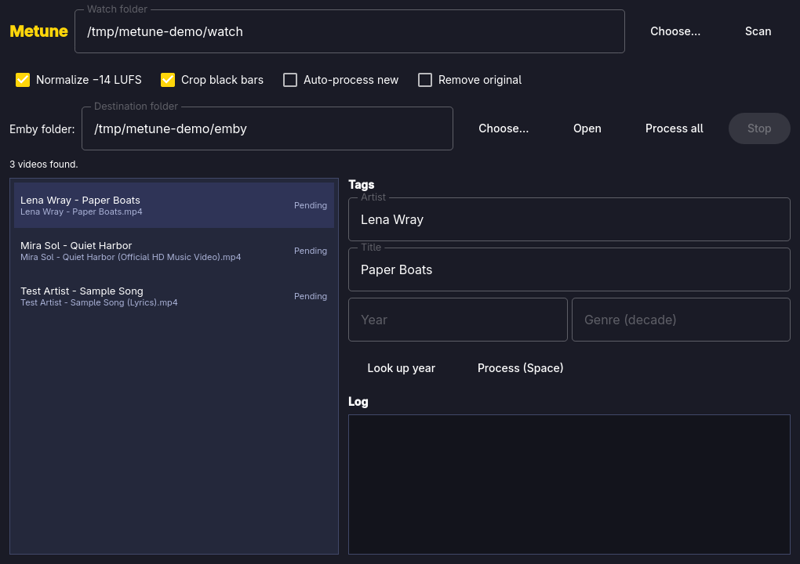

# Metune

One watch folder in, Emby-ready files out. Metune cleans MeTube music videos:
tidy `Artist - Song` names, Mp3tag-style tags, a decade Genre, −14 LUFS audio,
and black bars cropped — without touching your originals.



## How it maps to your workflow

| Your step | Metune does |
|---|---|
| MeTube downloads to `/mnt/pool/USENET/MeTube` (root or a playlist subfolder like `NEWMUSIC`) | Watches that folder recursively, skipping `.metube`, hidden folders, and `.part` downloads |
| Strip the filename to `Artist - Song`, removing `(Official HD Music Video)` | Parses `Artist - Song`, strips trailing junk like `(Official …)`, `[Lyrics]`, `(Official Audio)` — but keeps meaningful titles like `I Ran (So Far Away)` |
| Tag Artist and Song with Mp3tag | Writes the same `artist`/`title` metadata into the MP4 with ffmpeg, so Emby sees them |
| Google the song, set Genre to its decade (`2010's` for a 2016 song) | Looks the recording up on MusicBrainz and sets `date=<year>` + `genre=<decade's>`; edit Year/Genre by hand if it's offline or wrong |
| Shutter Encoder → Audio Normalization, −14 LUFS | ffmpeg loudnorm two-pass to `I=-14 TP=-1.5 LRA=11` — the same loudness target Shutter uses |
| HandBrake `Music Videos` preset if black bars | ffmpeg `cropdetect` + crop — same end result (bars removed), no GUI preset needed |
| Move to `/mnt/pool/Videos/Music Videos/MeTube` for Emby | Saves a **fresh copy** there (atomic rename, never overwrites); the watched original stays unless you tick *Remove original* |

## Use it

- Launch **Metune** from the app launcher (`Super + Space`).
- The watch folder defaults to `/mnt/pool/USENET/MeTube`, the Emby folder to `/mnt/pool/Videos/Music Videos/MeTube`. Change them in the two fields at the top, or choose a different folder for a one-off scan.
- **Scan** lists what's there. Click a row, check Artist/Title, **Look up year** to fill in the decade, then **Space** (or *Process all* / `A`) to clean it. Tick *Auto-process new* to handle new MeTube arrivals as they land.
- Point it at any folder to process it a different way — no need to use the MeTube folder.

Nothing is overwritten and originals are never modified: output goes to a
temporary file and is renamed into place, and *Remove original* is off by
default.

## Agent / command line

```sh
metune scan /mnt/pool/USENET/MeTube --json
metune lookup "Evanescence - My Immortal" --json
metune process /mnt/pool/USENET/MeTube/NEWMUSIC/"Evanescence - My Immortal (Official HD Music Video).mp4" --json
```

`metune open` opens the GUI. `metune` alone prints help. Every subcommand
exits `0` on success, `1` on error (details on stderr), and accepts `--json`.

## Shortcuts

| Key | Action |
|---|---|
| Space | Process selected video |
| A | Process all pending |
| S | Scan watch folder |
| L | Look up release year |
| Q | Quit |
| ? | Show/hide help |

## Build

```sh
./bin/build   # qmake6 + make into build/metune
./bin/test    # Qt Test suite, offscreen
./bin/install # makepkg -fsi, so it lands in the app launcher
```
